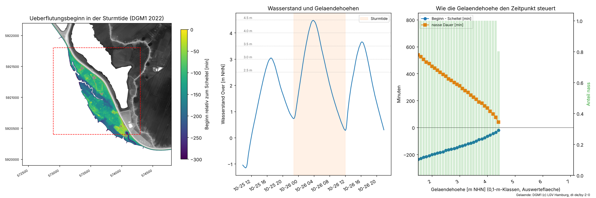
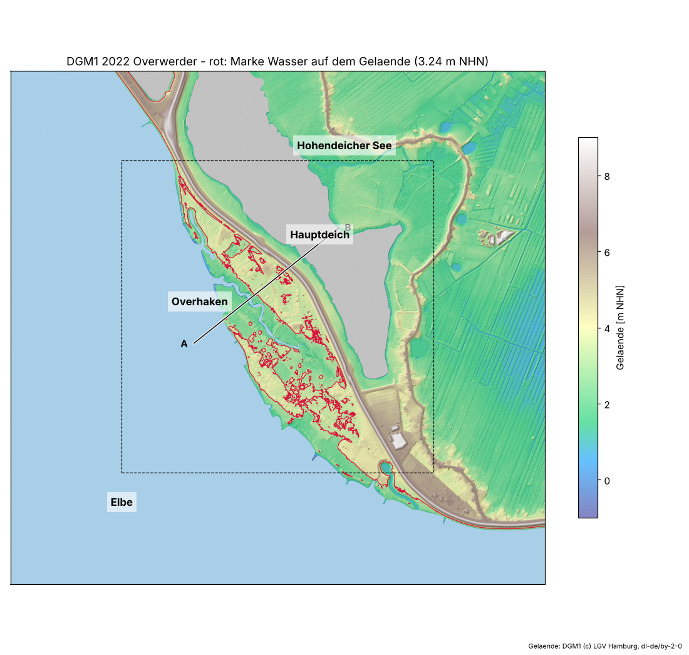
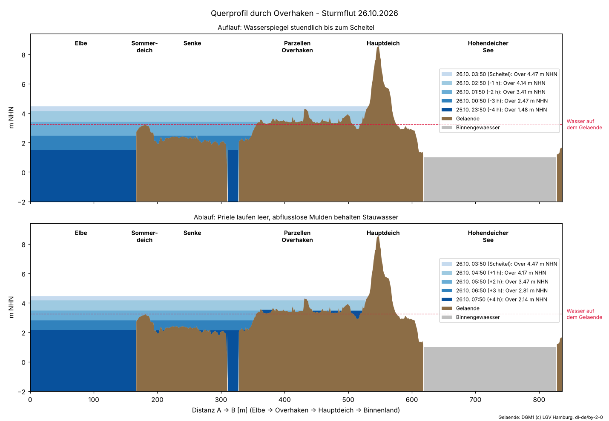
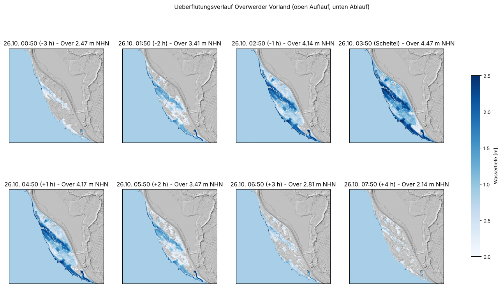

# Überflutungs-Zeitpunkte Overhaken / Overwerder (DGM1)

`inundation.py` berechnet für jede 1-m-Zelle des Overwerder Vorlands, **wann**
sie bei einer Tide nass wird, wie lange sie nass bleibt und wie tief das Wasser
steht. Damit lässt sich direkt ablesen, wie die Geländehöhe einer Parzelle
den Zeitpunkt bestimmt.









## Daten

| | |
|---|---|
| Gelände | **DGM1 2022**, LGV Hamburg (Laserscanning, 1 m, EPSG:25832, m ü. NHN/DHHN2016, ±15 cm) |
| Bezug | Transparenzportal „Geländemodelle Hamburg – DGM“; ZIP (1,3 GB) auf `archiv.transparenz.hamburg.de`, die alten `daten-hamburg.de`-Links liefern 404 |
| Download | per HTTP-Range nur die 1-km-Kacheln des Ausschnitts (`remotezip`), Cache `out/dgm1/` |
| Lizenz | Datenlizenz Deutschland – Namensnennung 2.0, © LGV Hamburg |
| Wasserstand | Pegel Over, cm über PNP → m NHN mit **PNP = −5,098 m NHN** (PEGELONLINE `gaugeZero`, nicht −5,00) |

Fallstricke im DGM1:

* Wasserflächen sind mit glatten Platzhaltern gefüllt (Elbe **2,00 m**,
  Hohendeicher See **1,00 m**). Ungefiltert wirkt die Elbe als künstliche
  2-m-Schwelle. `water_fill_mask` setzt sie auf NaN.
* Das niedersächsische Ufer fehlt (NaN). Die größte NaN-Fläche ist der Strom
  und damit die Wasserquelle.

## Methode

1. **Überlaufhöhe** je Zelle: Das ist der niedrigste Elbe-Wasserstand, bei dem
   die Zelle über einen zusammenhängenden Weg nass wird (Minimax-Pfad,
   morphologische Rekonstruktion durch Erosion, 8er-Nachbarschaft). Senken
   hinter einem Sommerdeich laufen also erst bei dessen Überströmung voll.
   Das Hinterland hinter dem Hauptdeich (Krone ≥ 8 m NHN) bleibt trocken.
2. **Auflauf**: In der Sturmtide (Tnw vor bis Tnw nach dem Scheitel) wird
   eine Zelle nass, sobald `h(t) ≥ Überlaufhöhe` gilt. Daraus ergeben sich
   Beginn und maximale Tiefe. Die Berechnung ist vektorisiert (laufendes
   Maximum + `searchsorted`), ~10 s für 5,5 Mio. Zellen.
3. **Ablauf**: Fällt der Strom, sinkt der Spiegel einer Zelle nur bis auf ihre
   Überlaufhöhe (Spiegel = `max(h, Überlaufhöhe − Ablaufrate · Δt)`). Was über
   Priele mit dem Strom verbunden ist, läuft mit der Tide ab. Abflusslose
   Mulden behalten **Stauwasser** bis zu ihrer Schwelle (`residual_depth`).
   `--drain-cm-h` lässt es mit fester Rate sinken (Siele/Versickerung,
   Default 0). Unter den Außenwasserstand sinkt es nicht, weil das Siel dann
   geschlossen ist. `depth_at` liefert die Tiefenkarte für einen beliebigen
   Zeitpunkt.
4. **Auswertung** über `OVERHAKEN_BBOX` (Vorland: Überlaufhöhe < 7 m),
   gruppiert in 0,1-m-Höhenklassen → `hoehe_zeitpunkt.csv`.

Grenzen: Es ist ein Badewannenmodell ohne Fließwiderstand und Einströmzeit, der
Beginn ist also der **früheste** mögliche Zeitpunkt. Der Ablauf über Priele
erfolgt ebenfalls sofort, und die Ablaufrate von Stauwasser ist unbekannt und
deshalb nur ein Parameter. Die Wasserspiegellage
von Over gilt für das ganze Vorland (Over liegt gegenüber, km 605,3). Zäune,
Lauben und Sandsäcke sind nicht im DGM enthalten. Archivdaten vor 2019-11
könnten einen anderen PNP haben (`--gauge-zero`).

## Ergebnis Sturmflut 26.10.2026

Scheitel 957 cm PNP = 4,47 m NHN um 04:50 MEZ (Over). Auswertefläche 44 ha,
davon 95 % nass. Am Ende der Sturmtide stehen noch auf **6,6 ha** Stauwasser,
meist flache Pfützen (Median 7 cm) und vereinzelt abflusslose Gräben bis
1,8 m. Die nasse Dauer zählt Stauwasser bis zum Ende der Sturmtide mit.

| Gelände [m NHN] | Beginn vor Scheitel | nass | max. Tiefe |
|---|---|---|---|
| 2,0 | 4 h 20 min | 7,6 h | 2,4 m |
| 2,6 | 3 h 45 min | 6,0 h | 1,8 m |
| 3,0 | 3 h 20 min | 5,2 h | 1,4 m |
| 3,4 | 2 h 55 min | 4,0 h | 1,0 m |
| 3,8 | 2 h 25 min | 3,0 h | 0,6 m |
| 4,2 | 1 h 45 min | 1,7 h | 0,2 m |
| 4,4 | 1 h 20 min | 0,7 h | 0,05 m (80 % nass) |

Faustregel: Auf dem steigenden Ast bedeuten **10 cm mehr Gelände rund
6–8 min späteren Beginn und ~15 min weniger nasse Zeit**. Nahe dem Scheitel
steigt das Wasser langsamer, sodass 10 cm dort 10–15 min ausmachen und
darüber entscheiden, ob eine Parzelle überhaupt nass wird. Zum Vergleich
liegt die Marke „Wasser auf dem Gelände“ (834 cm am Pegel Over) bei
3,24 m NHN, also mitten in der typischen Parzellenhöhe von 3,0–3,6 m.

## Aufruf

```bash
uv sync --extra gelaende
uv run python inundation.py --recent --animate          # höchste Tide der letzten 31 Tage + GIF
uv run python inundation.py --recent --drain-cm-h 10    # Stauwasser sinkt 10 cm/h
uv run python inundation.py --data web/public/data.json # aktuelle Vorhersage
uv run python inundation.py --event 2013-12-06          # PEGELONLINE-Archiv
uv run python inundation.py --demo --peak-cm 960        # synthetisch
```

Ausgabe in `out/inundation/`: Grafiken `inundation.png` (Übersicht),
`gelaende.png`, `profil.png` (Querprofil A–B, Auf- und Ablauf), `verlauf.png`
(stündliche Tiefenkarten −3 h … +4 h), mit `--animate` `animation.gif`
(10-min-Schritte, ~1 min Rechenzeit). Daten: `hoehe_zeitpunkt.csv`,
`spill_m_nhn.tif`, `onset_min_rel_peak.tif`, `hours_wet.tif`, `max_depth_m.tif`,
`residual_depth_m.tif`
(GeoTIFF, EPSG:25832, z. B. in QGIS über ein Luftbild legen).
